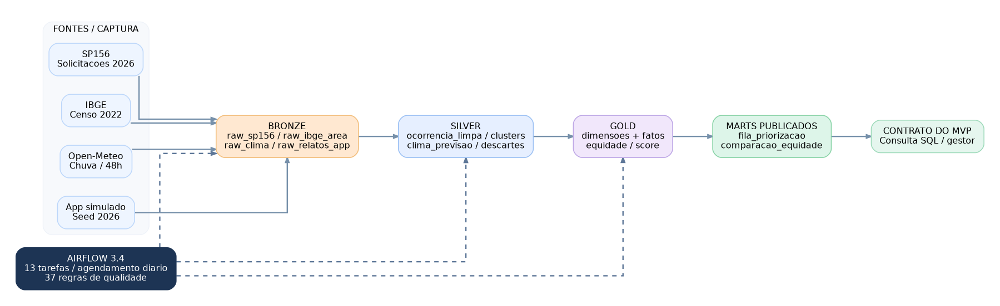

# Fila Justa | Pipeline de dados

**Big Data Architecture & Data Integration - Global Solution 2026.2**  
São Paulo, Brasil | Airflow 3.4.0 + PostgreSQL 16 + Python + H3 | ELT

## O que este repositório entrega

Pipeline orquestrado de ocorrências urbanas do **SP156**, enriquecidas com população por distrito do **Censo IBGE 2022**, previsão de precipitação **Open-Meteo** e relatos de aplicativo **simulados com semente fixa**. O produto é `gold.mart_fila_priorizacao`: fila explicável com risco, exposição, tempo, clima e fator de equidade, além de `gold.mart_comparacao_equidade` para comparar antes/depois.

**Escopo temporal:** ocorrências de 2026; no registro de novembro de 2026, os CSVs municipais publicados abrangiam **1º, 2º e 3º trimestres**, não o quarto. O IBGE é de 2022 (referência demográfica). A previsão de chuva é **das próximas 48 horas da rodada**, não chuva histórica de 2026.

## Arquitetura



Fontes -> **bronze** (campos operacionais originais) -> **silver** (padronização, H3 e clusters) -> **gold** (dimensões, fatos, equidade, score e duas views para o MVP). A DAG `dags/fila_justa_pipeline.py` liga **13 tarefas** desde o preparo do banco até os **37 testes de qualidade** e a conferência final dos marts. Agendamento `0 6 * * *` em `America/Sao_Paulo`, `catchup=False`, duas novas tentativas por tarefa e `max_active_runs=1`.

- Diagrama entidade-relacionamento: [docs/modelo_er_gold.png](docs/modelo_er_gold.png)
- Dicionário integral: [docs/dicionario_dados.md](docs/dicionario_dados.md)
- Fontes e limites: [docs/fontes.md](docs/fontes.md)
- Decisões e ELT: [docs/decisoes.md](docs/decisoes.md)
- Simulação: [docs/simulacao.md](docs/simulacao.md)

## Pré-requisitos

- Docker Desktop com `docker compose`, memória e espaço compatíveis com o Airflow local; conexão à internet para CKAN, IBGE e Open-Meteo.
- **Git Bash** (Windows) ou terminal Unix. A execução foi validada em Windows + Docker.
- Opcional, para executar testes no host: Python 3.13/3.14, `psycopg[binary]` e `tzdata` no Windows. H3 é instalado na imagem do Airflow.
- PostgreSQL é executado no serviço `warehouse`, separado do banco de metadados do Airflow. Porta local padrão: `5433`.

## Como executar do zero (Docker)

**Não** use `docker compose down -v` no ambiente em que queira preservar os dados: a opção `-v` apaga os volumes do Postgres. Execute na raiz deste repositório.

```bash
cp .env.example .env
```

Edite `.env`: troque `FERNET_KEY`, `WAREHOUSE_PASSWORD` e a senha de acesso à UI. Gere uma chave Fernet com:

```bash
python -c "from cryptography.fernet import Fernet; print(Fernet.generate_key().decode())"
```

Inicialize o Airflow e suba os serviços com a imagem que contém H3:

```bash
docker compose -f docker-compose.yaml -f docker-compose.h3.yaml up airflow-init
docker compose -f docker-compose.yaml -f docker-compose.h3.yaml up -d --build
docker compose ps
```

Se o primeiro comando retornar erro, consulte seus logs antes de avançar. No Airflow (`http://localhost:8080`), autentique-se com o usuário configurado, localize `fila_justa_pipeline`, habilite-a se estiver pausada e use **Trigger**. A DAG também tem agendamento diário, mas a primeira validação pode ser manual.

Conferir parsing/registro no Airflow:

```bash
docker compose exec -T airflow-dag-processor airflow dags list-import-errors --local
docker compose exec -T airflow-dag-processor airflow dags list --local
docker compose exec -T airflow-dag-processor airflow dags list
```

A execução consulta as fontes públicas, cria as camadas e publica `gold.mart_fila_priorizacao`. No **primeiro** processamento o SP156 pode demorar devido ao volume. Quarto trimestre só será incluído se o recurso CSV estiver publicado. O arquivo `include/seeds/pontos_clima_ibge_sp.csv` já é versionado e validado contra os códigos territoriais.

### Testes automatizados

No Python do host (Windows com Git Bash):

```bash
python -m pip install 'psycopg[binary]' tzdata
python -m unittest discover -s tests -v
```

A execução evidenciada em novembro de 2026 retornou **116 testes, OK**. Há também verificações SQL independentes integradas à DAG; uma falha termina a tarefa com erro.

### Conferir o resultado no warehouse

```bash
docker compose exec -T warehouse sh -c \
'psql -X -v ON_ERROR_STOP=1 -U "$POSTGRES_USER" -d "$POSTGRES_DB"' \
< docs/evidencias/consultas_validacao.sql
```

Exemplo de consulta do contrato do MVP:

```sql
SELECT rank, cluster_id, tipo, area_nome, n_relatos,
       fator_equidade, chuva_48h_mm, score_0_100, explicacao, run_id
FROM gold.mart_fila_priorizacao
ORDER BY rank
LIMIT 10;
```

A view **sempre associa score e fato pela mesma `run_id`**. Histórico por rodada permanece em `gold.fact_score` e `gold.fact_equidade_area`, enquanto `gold.fact_ocorrencia` representa o estado corrente por cluster. Nova DAG Run gera novo `run_id`: isso **não é duplicação** na Bronze/Silver.

## Configurações do score e equidade

Pesos em `include/config/weights.yml`: risco 40, exposição 30, tempo 10, clima 20; saturações de 20 relatos, 30 dias e 50 mm. A exposição é multiplicada pelo fator de equidade, calculado em função de relatos elegíveis observados/esperados; `k=10`, `alpha=0.5`, limite `M=2`. A nota final é normalizada pelo máximo **130**. Risco e sensibilidade dos 5 tipos são hipóteses no seed `include/seeds/dim_tipo.csv`, não medidas empíricas.

Para a análise de sensibilidade, execute `docs/analise_sensibilidade.sql` e salve o resultado em `docs/evidencias/`. Sem executá-la, **não afirme números de mudança no ranking**.

## Evidências observadas (12/11/2026)

| Indicador | Resultado observado |
|---|---:|
| SP156 na Bronze | 1.525.907 linhas (1T a 3T/2026) |
| IBGE na Bronze | 96 distritos |
| Relatos simulados na Bronze | 889 linhas |
| Ocorrências Silver | 16.553 |
| Grupos / clusters | 11.163 |
| Publicação na fila do MVP | 11.163 clusters na rodada corrente |
| Qualidade SQL | 37/37 regras aprovadas |
| Testes Python | 116/116 aprovados |
| Airflow | print das 13 tarefas verdes |

Previsões climáticas são snapshots versionados, por isso a soma da Bronze pode exceder 4.608 (96 x 48) após várias rodadas. As contagens acima são da evidência capturada, não garantias para futuras execuções com fontes atualizadas.

Arquivos da execução disponíveis em `docs/evidencias/`: `dag_completa_verde.png`, `testes_116.txt`, `consultas_validacao.sql`, `resultados_validacao.txt`, `qualidade_37_ok.txt`, `qualidade_falha_controlada.txt`.

**Atenção:** a falha controlada foi produzida em transação revertida (`ROLLBACK`) fora da DAG. Não há nesta pasta uma captura de **tarefa vermelha** obtida com injeção controlada na DAG; essa parte do aceite ainda exige evidência adicional. Também não foi anexada uma execução real em banco completamente vazio, apenas testes locais do bootstrap: realize a prova de ponta a ponta num ambiente isolado antes da entrega definitiva.

## Estrutura

```text
dags/              DAG Airflow completa (13 tarefas)
include/ingest/     SP156, IBGE, clima, app simulado, pontos distritais
include/transform/  Silver, clusters, equidade, clima, score, qualidade
include/sql/        DDL e transformações versionadas
include/config/     weights.yml - hipóteses de score
include/seeds/      Serviços, tipos, distritos e pontos climáticos
tests/              Testes unittest
docs/               Arquitetura, dicionário, fontes, decisões, evidências
```

## Fontes, licenças e atribuição

- **SP156**: [Prefeitura de São Paulo - Dados do SP156](https://dados.prefeitura.sp.gov.br/dataset/dados-do-sp156), recurso CKAN; dataset declara **CC0**. Os nomes de serviços elegíveis estão versionados no seed.
- **IBGE**: [Censo Demográfico 2022 - agregados por distrito](https://ftp.ibge.gov.br/Censos/Censo_Demografico_2022/Agregados_por_Setores_Censitarios/Agregados_por_Distrito_csv/), arquivo básico validado, malha territorial para pontos de consulta. Atribuição ao IBGE como fonte pública.
- **Open-Meteo**: [Forecast API](https://open-meteo.com/en/docs); *Weather data by Open-Meteo.com*, atribuição **CC BY 4.0**; conferir restrições de uso não comercial e limites da API.
- **Relatos de aplicativo**: sintéticos, gerados com semente e regras documentadas, sem pessoas reais.

## Privacidade, limitações e reprodução

A Bronze preserva somente as colunas operacionais necessárias; `Logradouro`, `Número`, `CEP` e textos livres não são persistidos. Não publique `.env`, arquivos de dados crus nem logs locais com segredos. `config/airflow.cfg` é configuração local e não deve ser versionada.

`limitação:` integração territorial por distrito pode perder registros cujo nome não é mapeável; a Silver usa caixa delimitadora geográfica, não teste ponto-em-polígono. Cluster H3 9 por tipo e janela de sete dias pode separar pontos em células vizinhas. Os 115 clusters transdistritais da rodada observada receberam o distrito do relato cronológico inicial. Os pesos, o indicador `necessidade=1` e a propensão sintética de reporte são hipóteses, **não comprovação de justiça material na cidade**. A Gold fato corrente não reconcilia exclusões de clusters entre rodadas futuras. Não misture previsão atual com histórico meteorológico de 2026.

**Entrega acadêmica:** link do repositório **público** + **PDF único** contendo arquitetura, dicionário, justificativa e referências às evidências. Ainda precisam ser conferidos os links externos e o cenário de banco vazio; o portal da disciplina é o destino final do envio.
